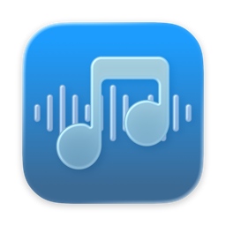
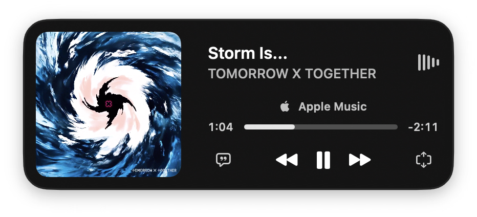
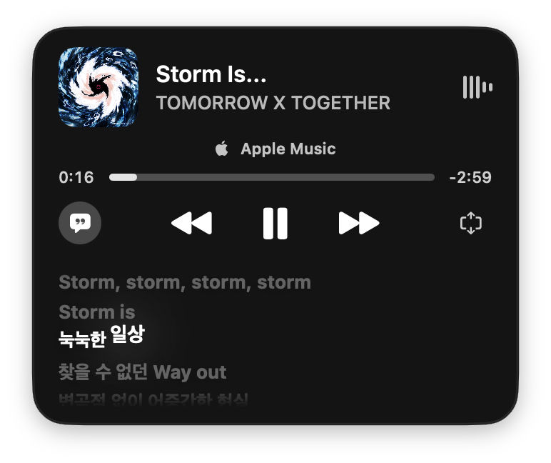
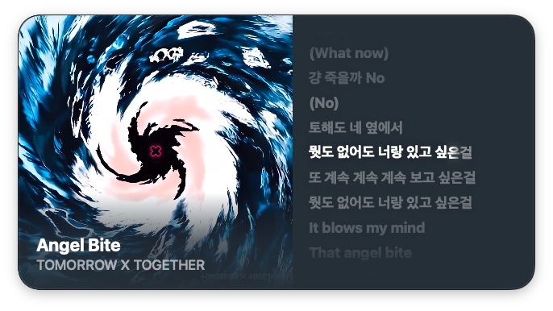
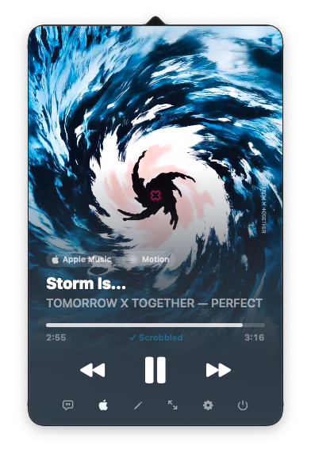

<div align="center">



# Musique

**A native macOS menu bar companion for Apple Music, Spotify and browser players.**

Time-synced lyrics · Last.fm scrobbling · a desktop player · a lock screen that plays along

[](https://github.com/NopXx/Musique/releases/latest)   [](#license)

[**Download**](https://github.com/NopXx/Musique/releases/latest) · [Features](#features) · [Install](#install) · [Build from source](#build-from-source)



</div>

---

## Screenshots

<table>
  <tr>
    <td align="center"><br><sub>Glass bar with lyrics</sub></td>
    <td align="center"><br><sub>Artwork card with lyrics</sub></td>
  </tr>
  <tr>
    <td align="center" colspan="2"><br><sub>Menu bar mini player</sub></td>
  </tr>
</table>

## Features

### 🎤 Lyrics that sing along

- **Word-by-word highlighting** from Apple Music's own lyrics, falling back to [LRCLIB](https://lrclib.net). Works for Spotify and browser tracks too, and picks up lyrics the Music app has already loaded on this Mac.
- **Held notes swell** the whole word: it grows, rises and glows for as long as the note lasts.
- **Backing vocals** get their own smaller row under the line, lit on their own timing.
- **Overlapping lines** each stay lit until they end. Instrumental breaks show a **• • •** that fills dot by dot.
- Shows where the lyrics came from, Apple Music or LRCLIB.

### 🎛 Players everywhere

| Where | What |
|---|---|
| **Menu bar** | Text, or a *Dynamic Island* pill with artwork, play/pause and a live audio waveform tinted to the cover |
| **Mini player** | Popover in three layouts: Classic, Tall and Immersive. Animated artwork, colour gradient, scrubber and lyrics |
| **Desktop player** | A floating *artwork card* (controls on hover) or a *glass bar* that follows the system Liquid Glass setting. Lyrics open beside or below it |
| **Fullscreen** | Motion artwork mirrored into the margins, lyrics, and a Liquid Glass clock |
| **Lock screen** | The now-playing card and fullscreen artwork drawn above the macOS login screen |
| **Widgets** | Small, medium and large Now Playing widgets with transport controls |

### 📊 Scrobbling & history

- **Last.fm**: now playing, plus one scrobble per play at a threshold you set. Failed scrobbles queue offline and retry.
- **Edit rules** rewrite artist, track or album before anything is scrobbled or shown. Set them up from the mini player and back them up as JSON.
- **Listening history**: every play, pause, resume and scrobble, in SQLite.

### 🔌 Integrations

- **Three sources**: Apple Music, Spotify and browser players via the [Web Scrobbler](https://web-scrobbler.com) extension. The active one is picked automatically.
- **Webhooks**: JSON payloads in Music-Scrobbler format, with an optional heartbeat.
- **Notifications** on track change and scrobble.
- **Now Playing takeover**: Musique owns the Control Center media slot.
- **Debug dashboard**: an opt-in local web page with live state, history, artwork and lyrics lookups.

### ⚙️ Everyday

- Checks GitHub for a new version once a day and tells you. You can also run *Check for Updates…* yourself.
- Launch at login, optional Dock icon, Thai and English.

## Install

1. Download `Musique-<version>.dmg` from [**Releases**](https://github.com/NopXx/Musique/releases/latest).
2. Open it and drag **Musique** to Applications.
3. Releases are signed for development and **not notarized**, so macOS may block the first launch. Allow it under **System Settings → Privacy & Security → Open Anyway**.

**Requires macOS 26 or later.**

### Permissions

macOS asks for each of these the first time it's needed:

| Permission | Used for | If you denied it |
|---|---|---|
| Automation (Apple Events) | Controlling Music / Spotify | System Settings → Privacy & Security → Automation → Musique |
| Apple Music (MusicKit) | Apple's word-timed lyrics (needs a subscription) | Lyrics come from LRCLIB instead |
| Audio capture | The live waveform | The waveform stays flat |
| Notifications | Track, scrobble and update banners | System Settings → Notifications → Musique |

Your data lives in `~/Library/Application Support/Musique/`:

| Path | Contents |
|---|---|
| `settings.json` | Settings |
| `history.db` | History, edit rules and pending scrobbles |
| `TTML/` | Lyrics cache |
| `Videos/` | Artwork cache |

## Build from source

You need **Xcode 26+** and [`xcodegen`](https://github.com/yonaskolb/XcodeGen) (`brew install xcodegen`).

```sh
cp Secrets.xcconfig.example Secrets.xcconfig   # optional: your Last.fm API key + secret
xcodegen generate
open Musique.xcodeproj                          # then Run
```

The `.xcodeproj` is generated and not committed, so regenerate it after every pull. To run the tests:

```sh
xcodebuild -project Musique.xcodeproj -scheme Musique -destination 'platform=macOS' test
```

<details>
<summary><b>Architecture</b></summary>

```
PlayerMonitor          ──┐
  Apple Music + Spotify  │
  (ScriptingBridge)      │
  + Web Scrobbler push   │
  + DistributedNotif     ├─►  ScrobblerService  ──►  Last.fm
  + 1 Hz tick timer      │      └─► PendingScrobbleQueue (retry)
                         ├─►  NowPlayingService (Takeover)
                         ├─►  WebhookDispatcher
                         ├─►  NotificationService
                         ├─►  HistoryRecorder ──► HistoryStore (SQLite)
                         ├─►  WidgetDataManager  ──►  App Group JSON + WidgetCenter reload
                         ├─►  MenuBarController + MiniPlayer (SwiftUI)
                         ├─►  DesktopMiniPlayerController (card / glass bar)
                         ├─►  LyricsService  ──►  Apple TTML (MusicKit) / LRCLIB
                         └─►  LockScreenController
                                └─► SkyLightOperator (private CGS space pinning)

MusicAudioLevelMonitor  ──►  Core Audio Process Tap → vDSP FFT → 10 bands
                             └─► menu bar / mini player / lock screen waveforms
UpdateService           ──►  GitHub releases, once a day
EditHistoryService      ──►  applies rules before scrobble / webhook / display
```

- `PlayerMonitor` owns one ScriptingBridge object per player and listens to each player's distributed notifications. A 1 Hz timer moves the position forward between them. Web Scrobbler tracks are pushed to a loopback webhook instead.
- `MusicAppController` sends control commands to whichever player is active, on a background queue.
- `HistoryStore` is an `actor` wrapping `sqlite3` directly, with no third-party dependency.

</details>

<details>
<summary><b>Project layout</b></summary>

```
Musique/Sources/
  Player/          PlayerMonitor, MusicAppController, NowPlayingService,
                   MusicAudioLevelMonitor, WebScrobblerReceiver, WidgetDataManager
    Bridge/        Music.h (sdef-generated), Spotify.h, stubs
  Scrobbler/       LastFMClient, ScrobblerService, PendingScrobbleQueue
  Lyrics/          LyricsService (Apple TTML, LRCLIB, parsers, prefetcher), BackgroundVocals
  Artwork/         ArtworkService, ColorExtractor, CustomArtworkStore
  History/         HistoryStore, HistoryRecorder, EditHistoryService
  Notifications/   NotificationService
  Webhooks/        WebhookDispatcher
  Services/        DebugServer, LaunchAtLoginService, UpdateService
  Helpers/         L10n, TextShape
  Settings/        SettingsStore
  UI/              menu bar, mini player, desktop player, fullscreen, settings
    LockScreen/    LockScreenController, SkyLightOperator, LockScreenPlayerView
  Wallpaper/       motion wallpaper (inactive)
MusiqueWidget/     WidgetKit extension + App Intents
MusiqueWallpaper/  wallpaper ExtensionKit appex
Shared/            App Group identifier
MusiqueTests/      unit tests
web/               debug dashboard
docs/              design notes (Apple Music TTML pipeline)
project.yml        xcodegen spec
```

</details>

## Roadmap

- Move the Last.fm session key from `settings.json` to the Keychain
- Notarized releases, and installing updates from inside the app (it only checks and notifies today)
- Finish the Thai translation: a few labels in the mini player's edit panel are still English
- Waveform for browser playback (the audio tap only listens to Music and Spotify)

See [TODO.md](TODO.md) for the full list.

## Acknowledgements

- Artwork lookup: [`apple-music-artwork-search`](https://apple-music-artwork.nopxx.site/)
- Fallback lyrics: [LRCLIB](https://lrclib.net)
- TTML parsing: [MusanovaKit](https://github.com/rryam/MusanovaKit)

## License

MIT
